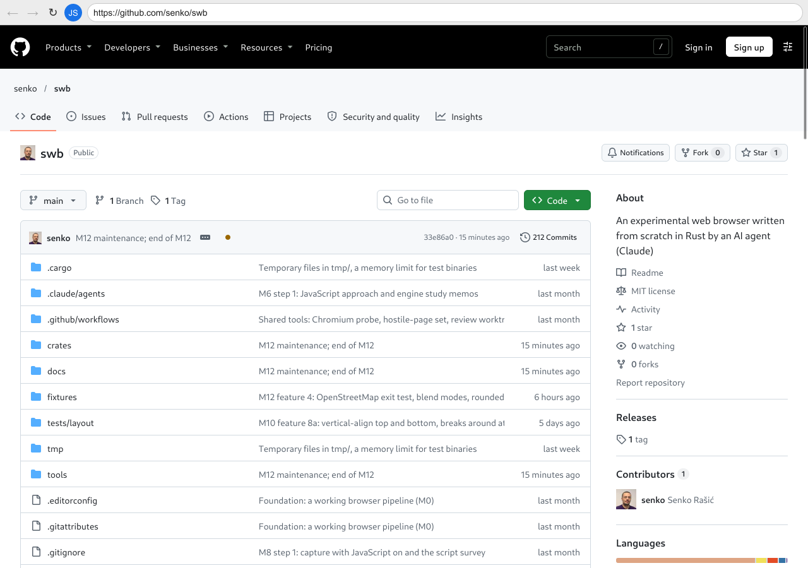

# swb

[](https://github.com/senko/swb/actions/workflows/ci.yml?query=branch%3Amain)

An experimental web browser, written from scratch in Rust.

An AI agent (Claude) designs, writes and maintains all of the code. The
project owner sets the goals and checks the results. See
[docs/ground-rules.md](docs/ground-rules.md).



*swb shows the GitHub page of this repository, with JavaScript on.*

swb uses general-purpose libraries (HTTP, TLS, HTML tokenizing, image
decoding, WOFF and WOFF2 decoding, font shaping, 2D rasterization,
windowing). The browser parts (CSS, style, layout, painting, page loading,
the JavaScript engine, the DOM and the other web APIs, user interface) are
written in this repository.

## Quick start

swb is developed and tested on Linux (Wayland or X11). Other platforms
are not tested.

Requirements (Debian/Ubuntu package names):

- Rust toolchain via [rustup](https://rustup.rs/). The version is pinned in
  `rust-toolchain.toml` and installed automatically.
- `libfontconfig-dev`, `libxkbcommon-dev`, `libwayland-dev`, `pkg-config`.
- A C compiler, `make` and `sh` (`build-essential`): the build compiles
  jemalloc, the memory allocator of the binaries, from source (ADR 0029).
- [`just`](https://github.com/casey/just) (optional).

```sh
git clone https://github.com/senko/swb.git
cd swb
just run https://senko.net/                    # build (release) and open a window
just run --js https://github.com/senko/swb     # the same, with JavaScript on
```

Without `just`: `cargo run --release -p swb -- https://senko.net/`. The
binary is `target/release/swb`.

## Use

The toolbar has back, forward and reload buttons, the JavaScript toggle
(**JS**) and the address bar. In the address bar, an address without a
scheme gets `https://`, and an absolute path opens a local file. On the
command line, a relative file path also works.

| Key                                  | Action |
|--------------------------------------|--------|
| Ctrl+L                               | Focus the address bar |
| Alt+Left, Alt+Right, mouse back and forward buttons | Back, forward |
| Backspace                            | Back (when no text field has the focus) |
| F5, Ctrl+R                           | Reload |
| Escape                               | Stop loading |
| Tab, Shift+Tab                       | Move the focus between links and form controls |
| Enter                                | Follow the focused link |
| Ctrl+A, Ctrl+C                       | Select all text, copy the selection |
| Ctrl+X, Ctrl+V                       | Cut, paste (in text fields and the address bar) |
| Ctrl+Shift+J                         | Turn JavaScript on or off |
| Ctrl+Q, Ctrl+W                       | Quit |

JavaScript is off by default. The JS button and Ctrl+Shift+J apply to the
next page that loads; reload to apply the change to the current page.
`--js` starts with JavaScript on. JavaScript needs a stack limit of at
least 8 MiB (`ulimit -s`). Below it, the button is gray and JavaScript
stays off.

Headless mode (for tests and scripts):

```sh
swb --headless --screenshot page.png https://senko.net/
swb --headless --full-page --screenshot page.png https://senko.net/
swb --headless --with-chrome --screenshot window.png https://senko.net/
swb --headless --dump-layout https://senko.net/
swb --headless --js --eval 'document.title' https://senko.net/
swb --headless --bench 20 https://senko.net/   # time each pipeline stage
```

Remote control: `swb --headless --remote-port 0` starts a WebSocket server
on 127.0.0.1 that tests and tools use to drive the browser (also with a
window: `swb --remote-port 9222`). See [docs/automation.md](docs/automation.md).

See `swb --help` for all options.

## Status

Early development.

- Eight [target pages](docs/targets.md) match Chromium:
  senko.net, Hacker News, a Wikipedia article, a Craigslist posting, the
  Ars Technica and BBC front pages, the GitHub page of this repository,
  and an OpenStreetMap map. All of them except senko.net also work with
  JavaScript on, with the interactions that the targets list names.
- swb has its own JavaScript engine (`crates/js*`); 41,842 tests of its
  [test262](https://github.com/tc39/test262) subset pass.
- Not done: running scripts in workers (`Worker` exists but runs no
  script), `window.open` and tabs, media playback, WebGL, CSS anchor
  positioning.

The [roadmap](docs/roadmap.md) lists the milestones, what each one
includes, and the backlog. The [development log](docs/devlog.md) has the
latest changes.

## Development

```sh
just check    # format check, clippy, all tests, license check
just --list   # all commands
```

[docs/testing.md](docs/testing.md) describes the tests and the tools that
compare swb with Chromium. [CLAUDE.md](CLAUDE.md) has the instructions and
the workflow of the AI agents that write the code.

## Documentation

- [Ground rules](docs/ground-rules.md), [target pages](docs/targets.md)
- [Architecture](docs/architecture.md)
- [Testing and tools](docs/testing.md), [performance](docs/performance.md)
- [Automation protocol](docs/automation.md)
- [Decision records](docs/adr/)
- [Roadmap](docs/roadmap.md), [development log](docs/devlog.md)
- [Credits and sources](docs/credits.md)

## License

swb's own source code is MIT-licensed. See [LICENSE](LICENSE).

Some of swb's source code and some of the material in swb binaries are
third-party material that keeps its own license; the MIT License does
not apply to it:

- the Public Suffix List under the Mozilla Public License 2.0 (MPL-2.0, a
  one-off exception,
  [ADR 0014](docs/adr/0014-public-suffix-list-license-exception.md));
- stylesheets based on the WHATWG HTML Standard under CC BY 4.0;
- code derived from Chromium and Skia under the BSD-3-Clause license
  (copies of swb's source code and binaries must include their license
  texts), and one file derived from Servo under the MPL-2.0;
- the WebIDL files of `crates/web/idl/`, copied from WHATWG standards
  (BSD-3-Clause) and W3C specifications (W3C Software and Document
  License);
- tables generated from the Unicode Character Database and Unicode CLDR
  (Unicode License v3).

See [THIRD_PARTY_NOTICES.md](THIRD_PARTY_NOTICES.md) for the details and
license texts.

The test data in `fixtures/` (snapshots of web pages, fonts) is
third-party material under its own licenses; see
[fixtures/pages/README.md](fixtures/pages/README.md) and
[fixtures/fonts/README.md](fixtures/fonts/README.md). It is not part of
swb binaries. The fixtures for JavaScript (`fixtures/js/`) are local
only and not in the repository.
